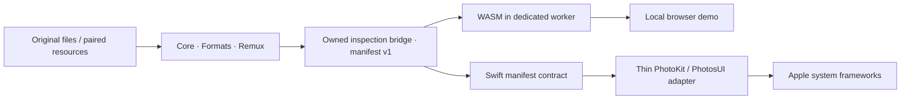

# Apple 公开 API 架构与本地演示

[English](APPLE_API_ARCHITECTURE.md)

既有 Rust **Core / Formats / Remux** 继续负责字节区间、配对、精确整数时间、方向/色彩事实、验证及有证据支持的保留式组合。没有用 Swift 或 JavaScript 重写 Apple 解析器。新的检查 bridge 是带版本的**适配 API**，不保证每个清单字段稳定。原始 Rust API 与消费方测试保持完整。

## 公开 API 映射

官方链接对应相关公开约定。本地文件解析、原生框架接收、编辑输出与照片应用体验是不同能力，证据不能互相代替。

| Apple 公开约定 | 职责与实现 | 状态和验证边界 |
| --- | --- | --- |
| [PHLivePhoto](https://developer.apple.com/documentation/photos/phlivephoto)、`request(withResourceFileURLs:placeholderImage:targetSize:contentMode:resultHandler:)`、取消及 degraded/error 键 | `PhotoKitAdapter.load` 接收静图与配对视频 URL，保留原生取消，忽略降级中间结果，只完成一次。Rust `Input::ApplePair` 验证真实元数据身份；`Input::Parts` 是调用方明确声明的关联。 | 已实现。在 83018c4/9fa6208 的 10 项真实 Swift 测试中，包含有效本地配对 PhotoKit 加载与逐字节 photo/pairedVideo 导出，以对应 CI 收据为准。解码清单不认证 URL，也不让其自动被 PhotoKit 接受。 |
| [PHAsset](https://developer.apple.com/documentation/photos/phasset)、[PHAssetResource](https://developer.apple.com/documentation/photos/phassetresource)、[PHAssetResourceManager](https://developer.apple.com/documentation/photos/phassetresourcemanager) | 列出资产/实况照片资源；按调用方选择导出照片、配对视频、调整或其他资源，使用原生进度、取消和字节预算。联网下载需明确选择，不按文件名配对或任取第一个视频。 | 适配层已实现。本地文件加载的 PHLivePhoto 资源导出已通过，不修改照片图库。图库 PHAsset 导出要求适当权限，测试不自动申请。I/O 错误可留下部分新目标，不覆盖已有文件或原媒体。 |
| [PHAssetCreationRequest](https://developer.apple.com/documentation/photos/phassetcreationrequest)、`.photo` / [`.pairedVideo`](https://developer.apple.com/documentation/photos/phassetresourcetype/pairedvideo) | `importPair` 在一次原生 changes 事务中加入两资源，`shouldMoveFile=false`，返回新建本地标识符。 | 适配层已实现。宿主获取添加权限，原生提交后明确不可取消。此处的真实有效配对导入和相册/照片接收仍为**未验证**，编译和 Web 播放不能代替。 |
| [PHLivePhotoView](https://developer.apple.com/documentation/photosui/phlivephotoview)、播放样式/代理/手势 | iOS/macOS `NativePlayback` 绑定真实视图、完整/提示播放、静音、开始/结束状态和系统手势识别器。 | iOS 适配层已实现，使用模拟器 SDK 编译门槛。调用方保留封装对象。macOS 无公开 playbackGestureRecognizer，明确报告不可用。d5729c7 的真实视图对象/生命周期测试已通过，该检查点有 11 项 Swift 测试；此处尚无设备播放/手势体验验收。 |
| [PHLivePhotoEditingContext](https://developer.apple.com/documentation/photos/phlivephotoeditingcontext)、帧处理器、音量、预览和编辑输出 | `NativeEditingSession` 持有真实上下文，转发原生帧处理块和音量，生成预览或写入 `PHContentEditingOutput`，传递取消与错误。宿主明确请求已授权编辑输入，再经 `PhotoKitAdapter.commitEdit` 提交同资产输出。 | 适配层已实现，有原生 SDK 检查。预览/保存串行执行，要求调整数据及事先取得的宿主权限。真实渲染、输出接收、色彩/HDR 忠实性和资产提交需 Apple 样本/设备验证，不承诺照片私有效果。 |
| [AVCapturePhotoOutput](https://developer.apple.com/documentation/avfoundation/avcapturephotooutput)、实况照片拍摄设置和代理回调 | `LiveCaptureRequest` 与 iOS `CaptureContract.settings` 验证本地视频目标、输出支持/启用状态。宿主持有会话、权限、设备配置和代理，关联同请求的照片与视频完成/错误。 | **仅约定**，不是已实现的相机系统。核心/浏览器拍摄报告不可用，不宣称相机/设备测试。 |
| [LivePhotosKit Player](https://developer.apple.com/documentation/livephotoskitjs/livephotoskit.player)：`photoSrc`、[`videoSrc`](https://developer.apple.com/documentation/livephotoskitjs/livephotoskit.player/videosrc)、[`photoTime`](https://developer.apple.com/documentation/livephotoskitjs/livephotoskit.player/phototime)、[`frameTimes`](https://developer.apple.com/documentation/livephotoskitjs/livephotoskit.player/frametimes)、[`metadataVideoSrc`](https://developer.apple.com/documentation/livephotoskitjs/livephotoskit.player/metadatavideosrc) | `configureLivePhotosKitPlayer` 接受应用提供的 Apple Player 与 HTMLVideoElement，明确传入核心推导的 photoTime/frameTimes，可将原 MOV blob 作为 metadataVideoSrc。未知时间会失败，不使用伪造默认值。演示自身使用 HTML 媒体控件，不使用 Apple SDK。 | 绑定约定经单测。按用户引用的官方约定，URL videoSrc 可提供时间元数据，HTMLVideoElement 不自动检测这些值，metadataVideoSrc 可单独提供原 MOV 时间。**不加载或测试 Apple CDN/运行时。** |

文档获取限制（2026-10-19）：曾打开官方页面，但 Web 读取器只收到 JavaScript 外壳；关联 Markdown 返回 `Unsupported content-type: text/markdown`，容器直接请求 JSON 返回 `Tunnel connection failed: 403 Forbidden`。上述 LivePhotosKit 时间区别来自用户提供并引用的约定，作为本绑定行为实现和测试，**不属于独立获取全文后的文档核验**。未改变或绕过访问控制。原生 SDK 编译验证签名，不验证全部 API 语义。

## 资源与操作约定

`liblivephoto-bridge::inspect` 接受现有 `Input` 变体，返回自持有清单及精确静图/视频字节。原生 JSON 示例与 WASM 绑定共用代码。跨 JSON 的 64 位时间、区间或时长都用十进制**字符串**，时间尺度仍为正整数。JavaScript 只在播放边界转为浮点，精确值仍可查看和下载。Swift 解码精确 `Int64`/`UInt32`，向 `CMTime` 转换时拒绝超出正 `Int32` 的尺度，不舍入。

`video_frame_times` / `MotionPhoto::frame_times` 复用核心样本表解析，读取 `stts`、有符号/无符号 `ctts`，保留解码样本索引，按呈现时间排序，并映射含空编辑的单位速率编辑列表。不同影片/媒体尺度精确组合，溢出失败，分配及编辑/样本迭代都有界。分片、非单位编辑或缺少样本表会明确报错；预览帧时间不可用时，影片仍可保留和提取。不推断恒定帧率，不伪造零时间；既有 1/3 秒微秒转换拒绝仍有测试。

Rust bridge 提供真实 Parse / Validate / Extract / Complete 阶段与回调取消。同步解析在阶段内部不可中断。Web 解析运行于独立 worker，取消/替换时终止；输入读取期间中止 FileReader，过期代次不能输出结果。读取进度使用真实字节，解析阶段进度不确定。替换或页面释放时撤销所有结果媒体 URL。

Swift `NativeOperation` 提供进度、成功/失败/取消终态与准确一次完成，已测试标识符/取消竞争及过期完成。原生库变更和导出写入跨越明确提交边界，之后取消返回 false。错误保留原生错误或类型化适配失败。拍摄和照片私有效果返回文档规定的不可用原因，不返回空成功桩。

## 本地浏览器行为

可运行的 [Web 演示](web/README.zh-CN.md)接受支持的动态文件或 Apple 配对。普通未配对静图/视频要求调用方明确关联。Apple ID 不匹配始终失败，即使先前已有预览。页面显示资源区间、精确照片时间、实际样本帧时间、原始静图/视频提取、诊断和观察到的显示/色彩事实。未知 EXIF/色彩/HDR 保持未知，不将保留的 ICC、gain map 或 AGTM 元数据称为浏览器像素渲染。

播放器支持封面/视频切换、播放/暂停/静音、键盘、定位照片时间及按样本逐帧操作。兼容封面可以从精确照片时间的解码视频中绘制，也可由调用方明确提供 JPEG/PNG。两者都标为仅预览，不替换原静图，也不宣称 HDR 正确或像素等价。HEIC/HEVC 解码失败会显示，提取仍可用。没有隐式转码或远程转换；不支持视频的解码需要兼容浏览器/OS 或另行准备的本地预览，此阶段没有视频转码服务。

样本表时间、浏览器 seek 与源像素比较使用相同输入。合成第 13 帧为 **13/16 秒**封面，Android XMP 表示为 812500/1000000，Apple 元数据轨道表示为 1625/2000。测试比较有理数等价、帧位置、提取 MP4 字节和解码后的封面/视频像素，还测试无效配对、未知时间、不可用视频、取消、键盘及移动布局。

不上传文件，不获取 Apple 脚本/CDN/分析服务，服务器只绑定 `127.0.0.1`。只提供静态 GET/HEAD，拒绝上传方法；该本地演示未执行部署或公开发布。

## 尚待验证

[Google 清单](https://github.com/21Z121Z1/LibLivePhoto/blob/archive/evidence-20261030/evidence/GOOGLE_COMPLETE_INVENTORY.md)保留各 Google 接口、提供者、重封装和适配层未完成项，排除 Moments 构造。本地有效配对加载/导出已有真实测试和 RustCoreBridge C ABI 客户端，结果以对应 CI 收据为准。有效配对 PhotoKit 导入、编辑、播放及相册/照片体验仍需有权限的 Apple 设备/样本运行。Apple SDK 运行行为、完整官方文档、LivePhotosKit 运行时、Safari/Firefox 和硬件拍摄仍为独立验证任务。这是已实现架构与本地演示，不覆盖完整 Google 或 Apple 生态。

`d5729c7` Apple CI 检查点还构建静态 XCFramework，并在 iOS26.5 模拟器的自有 iPhone17e 实例上真实执行链接 Rust 的 Swift bridge，parse/精确时间、原视频提取、完整 AGTM 与错误均通过，见[收据](https://github.com/21Z121Z1/LibLivePhoto/blob/archive/evidence-20261030/evidence/mobile-and-sdk-d5729c7.json)。它不访问照片图库，也不证明真实显示/手势/HDR/相机接收。真实 LivePhotosKit 运行时仍被环境代理 CDN 403 阻断，见[livephotoskit-access.json](https://github.com/21Z121Z1/LibLivePhoto/blob/archive/evidence-20261030/evidence/livephotoskit-access.json)，不能把绑定单测视为 Apple SDK 运行。
